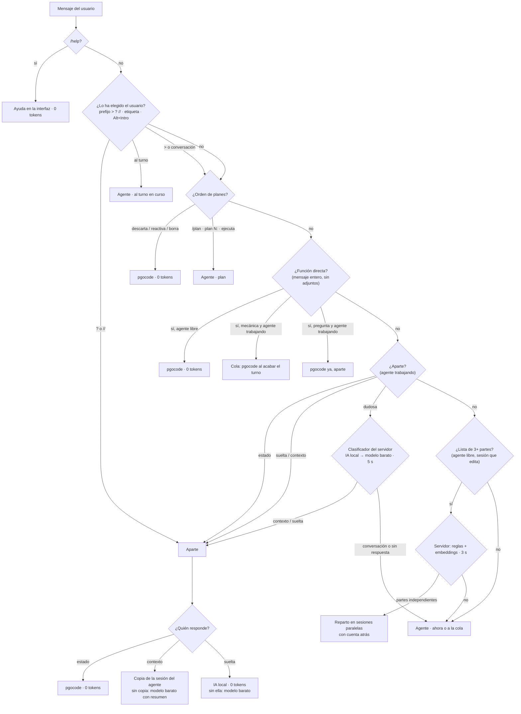

# Enrutador de intenciones: quién hace qué en pgocode

Cada mensaje que escribe el usuario lo atiende **una sola** pieza. Ir siempre al agente es lo caro: cada turno reenvía
todo su contexto (decenas de miles de tokens). El enrutador decide, en un **orden fijo**, quién lo hace; la primera
etapa que encaja con seguridad gana y, en la duda, el mensaje va al agente (que el agente no pierda una orden importa
más que algo de ruido en su contexto).

- Código de referencia: `web/src/router.ts` (función pura `route()`, comentario de cabecera) y sus pruebas
  `web/src/router.test.ts` (más de 70 mensajes con su ruta esperada).
- Despacho: `web/src/componentes/Chat.tsx` (`decideYEnvia` al pulsar Intro; `envia` para lo que sale de la cola, los
  planes y las hijas de un reparto). Ninguno decide por su cuenta: piden la decisión al enrutador.
- Registro: `internal/router` (tabla de rutas y validación) y `POST /api/ruta` (`internal/servidor/ruta.go`).
- Lo ve el usuario: la etiqueta encima del cuadro de texto, el distintivo de cada mensaje, `/help` y la ventana de
  Actividad.

## Tres cosas distintas

- **Destinos**: quién hace el trabajo (pgocode, una copia del agente, la IA local, un modelo barato, sesiones
  paralelas, el agente).
- **Motores de decisión**: quién decide a qué destino va (el usuario, reglas, correcciones aprendidas, embeddings,
  la IA local, el modelo barato).
- **Modificadores**: cambian cómo llega el mensaje al agente, no a quién (cola, al turno en curso, skill, subagentes,
  relevo, poda…).

## Destinos, en orden de evaluación

| # | Destino (`route`) | Quién lo ejecuta | Coste | Contexto que usa | Cuándo se elige | Motor que decide | Respaldo si no está | Código |
|---|---|---|---|---|---|---|---|---|
| 0 | Orden de pgocode (`command`) | pgocode: `/help`, «descarta / reactiva / borra el plan N». El agente, en solo lectura: `/plan …`, «plan N: …»; con permiso de editar: «ejecuta el plan N» | 0 tokens (las que hace pgocode) | ninguno / el del agente | el mensaje es una orden de pgocode | reglas (`esAyuda`, `PL.interpreta`) | — | `web/src/ayuda.ts`, `web/src/plan.ts`, `Chat.tsx` (`ordenPlan`, `ejecutaPlan`) |
| 1 | Función directa (`direct`) | pgocode | 0 tokens (el mensaje de commit lo redacta la IA local o, sin ella, reglas) | git y la carpeta de la sesión; lo que ya sabe la interfaz | el mensaje **entero** es una orden mecánica (compila, tests, tipos, lint, commit) o una pregunta de estado (cambios, diff, ficheros, gasto, rama, último turno) | reglas (`DR.detect`, estrictas) | si no sabe con seguridad la orden del proyecto, al agente | `web/src/direct.ts`, `internal/servidor/directo.go` |
| 2 | Pregunta aparte (`aside`) | estado: pgocode · con contexto: una **copia** de la sesión del agente (Claude Code, OpenCode) · suelta: la **IA local** del equipo | estado 0 · suelta 0 con IA local · con contexto: lo que cueste la copia (o el modelo barato con el resumen) | estado: el turno en curso · contexto: la sesión del agente (copia que se tira) · suelta: ninguno | con el agente trabajando, algo que no le pide nada (¿cómo va?, una curiosidad, cultura general) o con los prefijos `?` y `//` | usuario (prefijo, etiqueta) > aprendidas > reglas > clasificador (IA local; si no, modelo barato) | contexto sin copia (Antigravity o sin sesión): modelo barato con el resumen de pgocode; suelta sin IA local: modelo barato | `web/src/aparte.ts`, `internal/servidor/aparte.go` (`aparte`, `aparteLocal`, `clasifica`, `clasificaMensaje`) |
| 3 | Reparto en subtareas (`split`) | sesiones paralelas de pgocode, cada una en su worktree y rama `pgo/<madre>-<n>`, unidas al acabar | lo de cada hija (cada una empieza sin el historial de la madre) | solo su parte y una línea con las demás | 3 o más partes independientes en una sesión que edita, en la raíz de un repositorio git | reglas (`RP.candidata`) y, en el servidor, reglas + embeddings (`ParallelParts`) | sin respuesta en 3 s o sin partes independientes: al agente; el usuario puede pulsar «Hacerlo en esta sesión» durante la cuenta atrás | `web/src/reparto.ts`, `internal/servidor/reparto.go`, `internal/repo/reparto.go`, `internal/llm/parallel.go` |
| 4 | IA local de texto | no es un destino del mensaje principal (ver más abajo) | 0 tokens | — | responde las preguntas aparte **sueltas**; decide (clasificación) y redacta (mensajes de commit) | — | modelo barato de pago | `internal/selector/localai.go` (`LocalChat`) |
| 5 | Agente (`agent`) | Claude Code, OpenCode o Antigravity: ahora, a la cola si está trabajando o al turno en curso | lo que reenvía el agente en cada paso | toda su sesión | todo lo demás | — | — | `internal/llm/agentes.go`, `internal/servidor/servidor.go`, `internal/servidor/inyecta.go` |

### Motores de decisión

En cada etapa se prueban en este orden; si uno no está o no responde a tiempo, la etapa cae a la siguiente y, al
final, al agente.

| Motor (`engine`) | Qué es | Dónde decide | Si no está |
|---|---|---|---|
| `user` | prefijos `>` (al agente), `?` (estado), `//` (aparte); la etiqueta; Alt+Intro (al turno) | todas: manda sobre lo demás | — |
| `rules` | expresiones regulares, sin IA | órdenes, directas, aparte (estado, órdenes, preguntas sueltas claras), candidata a reparto | — |
| `learned` | las correcciones del usuario (la etiqueta o los botones de una pregunta aparte), por firma del mensaje, por proyecto | aparte | — |
| `embeddings` | Ollama `embeddinggemma` en el equipo | partes independientes del reparto; skill de la petición; sugerencia de subagentes | solo reglas (por ficheros nombrados en cada parte) |
| `local-ai` | Ollama `gemma3:4b` en el equipo (NVIDIA T1000 8 GB) | clasificar un mensaje dudoso (conversación / contexto / suelta) | modelo barato |
| `cheap-model` | modelo barato de pago (Gemini, `llm.ModeloClasifica`), **solo de respaldo** | clasificar si no hay IA local o no responde en 6 s | a la conversación |

Tiempos máximos: clasificador 5 s en la interfaz (el servidor espera a la IA local 6 s la primera vez, cuando carga el
modelo); propuesta de reparto 3 s; skill elegida 1,5 s; pregunta suelta con la IA local 20 s.

### Modificadores del envío al agente

| Modificador | Qué hace | Quién lo decide | Código |
|---|---|---|---|
| `queue` | con el agente trabajando, a la cola; sale sola al acabar el turno (lo que sale junto, en un solo mensaje) | enrutador | `web/src/cola.ts` |
| `turn` | al turno en curso, sin esperar (Claude Code); con «Siempre al turno», `>` con el agente trabajando o Alt+Intro | usuario / opción | `internal/servidor/inyecta.go` |
| `plan` | petición de plan en solo lectura o ejecución con permiso de editar | reglas | `web/src/plan.ts` |
| `skill-user` | `/skill …` escrita por el usuario | usuario | — |
| `attachments` | con adjuntos: nunca función directa, aparte, reparto ni al turno | reglas | — |
| `cut` | «Continuar desde aquí» pendiente: el agente sigue desde ese punto (sin reparto) | usuario | `web/src/aparte.ts` (`cutRequest`) |
| `skill` | skill elegida por embeddings y se la indica al agente | embeddings | `internal/selector`, `/api/skills/elegir` |
| `subagents` | sugerencia de subagentes a Claude Code (exploración amplia o partes independientes) | reglas + embeddings, en el servidor | `internal/llm/parallel.go` (`ParallelHint`), `agentes.go` (`chatCompleto`) |
| `relay` | relevo: sesión nueva del agente con la memoria de trabajo en vez de todo el historial | política de contexto | `web/src/workingMemory.ts`, `contextPolicy.ts` |
| `memory` | memoria del proyecto (`<repositorio>/.pgocode/memoria.md`, fuera de git) al final del mensaje, solo cuando el agente empieza de cero: sesión nueva, relevo, «Vaciar contexto», compactación | reglas, en el servidor | `internal/memory`, `internal/servidor/memory.go` |
| poda, vigencia, compactación | retirar del historial lo que ya no hace falta; compactar al pasar el umbral | servidor, siempre | `internal/llm/prune*.go`, `vigencia.go`, `compaction.go`, `web/src/contextPolicy.ts` |
| continuación de OpenCode | al llegar al límite de pasos, sigue con otra petición en la misma sesión | servidor | `internal/llm/agentes.go` (`ContinuacionesOpenCode`) |
| idioma | el agente responde en el idioma del navegador | servidor | `llm.InstruccionIdioma` |

Los seis primeros los decide el enrutador antes de enviar; `skill` y `relay` se añaden al distintivo al enviar;
`subagents` y `memory` los avisa el servidor durante el turno (eventos `subagentes` y `memoria`); los demás los aplica siempre el servidor y
no se marcan en cada mensaje.

## Diagrama



## Ejemplos

| Mensaje | Situación | Ruta | Lo hace | Decide |
|---|---|---|---|---|
| `/help` | cualquiera | orden | pgocode | reglas |
| `descarta el plan 4` | agente libre | orden | pgocode | reglas |
| `/plan añade login con Google` | agente libre | orden · plan | el agente (solo lectura) | reglas |
| `ejecuta el plan 2` | agente trabajando | orden · cola | el agente al acabar el turno | reglas |
| `compila` | agente libre | directa | pgocode | reglas |
| `compila` | agente trabajando | directa · cola | pgocode al acabar el turno | reglas |
| `¿qué cambios hay?` | agente trabajando | directa · ya | pgocode, aparte | reglas |
| `compila y arregla los errores` | agente libre | agente | el agente | reglas |
| `>compila` | agente libre | agente | el agente | usuario |
| `compila` (con una captura) | agente libre | agente · adjuntos | el agente | reglas |
| `¿cómo va?` | agente trabajando | aparte · estado | pgocode | reglas |
| `¿cuál es la capital de Australia?` | agente trabajando | aparte · suelta | la IA local | reglas |
| `// ¿por qué has usado un mapa ahí?` | agente trabajando | aparte · contexto | copia de la sesión | usuario |
| `¿por qué has usado un bucle aquí?` | agente trabajando | dudosa → clasificador | lo que diga la IA local | IA local (o modelo barato) |
| `cambia el color del botón a rojo` | agente trabajando, «Siempre al turno» | agente · al turno | el agente ya | reglas |
| `sí, adelante` | el agente acaba de preguntar | agente · cola | el agente | reglas |
| lista de tres tareas independientes | agente libre, sesión que edita | reparto (tras confirmarlo el servidor) | 3 sesiones paralelas | embeddings |
| la misma lista | sesión de solo lectura | agente | el agente | reglas |
| `refactoriza el módulo de facturas` | agente libre | agente (+ skill o subagentes si encajan) | el agente | reglas |

## Lo que ve el usuario

- **Etiqueta** encima del cuadro de texto (`R.tagText`): adónde irá el mensaje mientras se escribe («→ Conversación»,
  «→ pgocode, sin el agente: compilar (0 tokens)», «→ Aparte · suelta (IA local)», «→ Conversación o reparto en
  subtareas: lo decide pgocode al enviar»…). Al pasar el ratón (`R.tagTitle`): quién lo hace, quién lo ha decidido
  y por qué. Un clic elige otro destino (lo elegido en contra de pgocode se aprende).
- **Distintivo** en cada mensaje del usuario (`R.badge`): «agente», «agente · cola · skill elegida», «agente · al
  turno», «pgocode», «agente · orden de plan», «reparto en 3», y en cada pregunta aparte «aparte · estado / copia /
  IA local / modelo barato». Una pregunta suelta respondida por la IA local ofrece «Con el modelo de pago».
- **Actividad** → «Enrutador»: «Esta sesión: 12 al agente · 3 directas · 2 aparte (1 IA local, 1 sin tokens) · 1
  reparto · 1 orden de pgocode. 7 de 19 sin tokens de pago.» (recuento por sesión en este navegador).
- **/help** → «Quién hace qué (enrutador)», que remite aquí.

## Registro y medida

Cada decisión se anota una vez (`registraRuta` en `Chat.tsx` → `POST /api/ruta` → `AnotaAgente(sesión, "ruta",
…)`) en el registro de tiempos (`~/.local/share/pgocode/tiempos/AAAA-MM-DD.jsonl`), con `destino`, `ejecuta`,
`motor`, `motivo`, `modificadores`, `detalle` y `ms` (lo que tardó en decidirse, con los pasos del servidor). Se
anota cuando se sabe de verdad: la función directa, al tener el resultado (si pgocode no sabe hacerla, se anota el
envío al agente); la pregunta aparte, al saber quién respondió; lo encolado, al salir de la cola; el reparto, al
lanzarse (si el usuario prefiere hacerlo en la sesión, se anota el envío al agente). La sugerencia de subagentes la
anota el servidor como `ruta-modificador`. Además siguen los sucesos de cada pieza (`directo`, `aparte`,
`clasifica`, `inyecta`, `agente-pide`…).

Cuántos mensajes van a cada sitio:

```sh
jq -r 'select(.ev=="ruta") | .destino + " " + .ejecuta' ~/.local/share/pgocode/tiempos/*.jsonl | sort | uniq -c
```

## La IA local como destino

**Decisión: sí, pero solo para las preguntas aparte sueltas** (cultura general, traducciones, qué significa algo).
Medido en el equipo de Luis (gemma3:4b en la T1000, en caliente) con diez preguntas de ese tipo: 9 correctas, entre
0,3 y 1 s cada una, 0 tokens. Falló un cálculo de husos horarios. Antes las respondía el modelo barato de pago.

- Respaldo: si no hay modelo de texto, no responde en 20 s o la respuesta está vacía, el modelo barato. El
  distintivo dice quién respondió y un botón la repite con el modelo de pago (`aparte_motor: "pago"`).
- **No** para preguntas con contexto: un modelo de 4B con un resumen de 12k caracteres de la conversación responde
  peor que la copia de la sesión del agente, que tiene el código y el historial reales.
- **No** como destino del mensaje principal (tareas pequeñas de código o texto): un 4B sin herramientas ni el
  contexto del agente se equivoca en lo que importa, y una respuesta mala al trabajo cuesta más que los tokens que
  ahorra. Sigue decidiendo (clasificación) y redactando (mensajes de commit), donde un error es barato y visible.
- No hay servidor de IA en la red: todo es el equipo del usuario. Si se cambia el modelo de texto (ajustes de la IA
  local), se usa el elegido; si no, el primero conocido que tenga (`gemma3:4b`, `gemma3:1b`, `qwen3:4b`,
  `gemma3:12b`).

## Incoherencias que se han resuelto al unificar

- **«>» con una orden directa a la cola se perdía**: con el agente trabajando, `>compila` iba a la cola sin el
  prefijo y, al salir, pgocode lo hacía en vez del agente. Ahora lo encolado a propósito para el agente lleva `>`
  delante y al salir sigue yendo al agente (`R.fromQueue`).
- **«>» repartía**: `>` es «directo a la conversación actual», pero una lista con `>` podía acabar en un reparto. Ya
  no (`>` y la etiqueta «Conversación» saltan el reparto).
- **La etiqueta mentía en las órdenes de planes, en `/help` y en las listas**: decía «→ Conversación» para «descarta
  el plan 2» (que hace pgocode sin agente), no decía nada para `/help` y no avisaba de un posible reparto. Ahora la
  etiqueta sale siempre de la misma decisión que el envío.
- **El motivo del clasificador decía siempre «modelo barato»** aunque hubiera decidido la IA local. El servidor
  devuelve el modelo y el motivo dice cuál fue.
- **Varias comprobaciones repetidas con condiciones distintas** (la función directa se miraba en tres sitios, con
  «adjuntos» o «adjuntos listos» según el sitio; la cola tenía su propio criterio de «qué sale solo»). Ahora una sola
  función (`R.route`, `R.standalone`).

Sin cambios a propósito: las órdenes de planes que hace pgocode siguen esperando en la cola si el agente trabaja
(«borra el plan 2» mientras el agente lo ejecuta podría pisarle el fichero), y las preguntas aparte solo se deciden
con el agente trabajando (con el agente libre no hay nada que interrumpir: en la duda, a la conversación).

## Otros «quién hace qué» (no enrutan mensajes)

- **Programas** (servidores, vigilantes, lo que se prueba en marcha): los ejecuta pgocode, no el agente. El agente los
  lanza con `pgo ejecutar <nombre> <orden…>` (siguen al acabar el turno); los que deja en segundo plano, pgocode se
  los queda al acabar su respuesta («adoptados»). Código: `cmd/pgocode/pgo.go`, `internal/procesos`.
- **Hilo de limpieza** (uno por sesión): el recolector de vigencia marca lo que ya no hace falta en el historial del
  agente y la poda lo retira al empezar el turno (o con «Barrer ahora»). Embeddings locales; sin Ollama, solo reglas.
  Código: `internal/llm/vigencia.go`, `prune*.go`, `web/src/cleaner.ts`, `CleanerIndicator.tsx`.
- **Imputación automática**: pgocode imputa en Odoo el tiempo de cada turno (proyecto y tarea de la sesión) sin el
  agente ni PlanesGo (`imputacion.Gestor`, `PLANESGO_GESTOR` por proceso). Las preguntas aparte suman su consumo a
  la sesión pero no cambian la descripción de la línea.
- **Google Drive, Docs y Sheets** (solo lectura): es una **herramienta**, no un destino. La usa el agente con
  `pgo drive buscar|listar|leer` (el uso de la orden se le añade solo al mensaje que menciona Drive, Docs, Sheets,
  «documento de Google» o una URL de docs.google.com: `internal/llm/pgohint.go`); pgocode lo lee a través de su
  navegador integrado, con la sesión de Google del usuario (sin ajustes). Un mensaje sobre Drive va al agente como cualquier otro. No hay función directa («busca en drive X»):
  la detección estricta de `direct.ts` reconoce mensajes que son *enteros* una orden fija, y aquí el resultado casi
  siempre lo necesita el agente en su contexto para seguir; leerlo él cuesta lo mismo que pegárselo después.
  Igual **Gmail** (solo lectura): `pgo gmail buscar|listar|leer`, con su línea de uso solo en el mensaje que habla
  del correo, el email, Gmail o la bandeja (no en «el campo email» y parecidos).
  Código: `internal/gbrowser`, `internal/servidor/google.go`, `electron/googleReader.js`, `cmd/pgocode/pgo.go`; ver
  `docs/google-workspace.md`.
